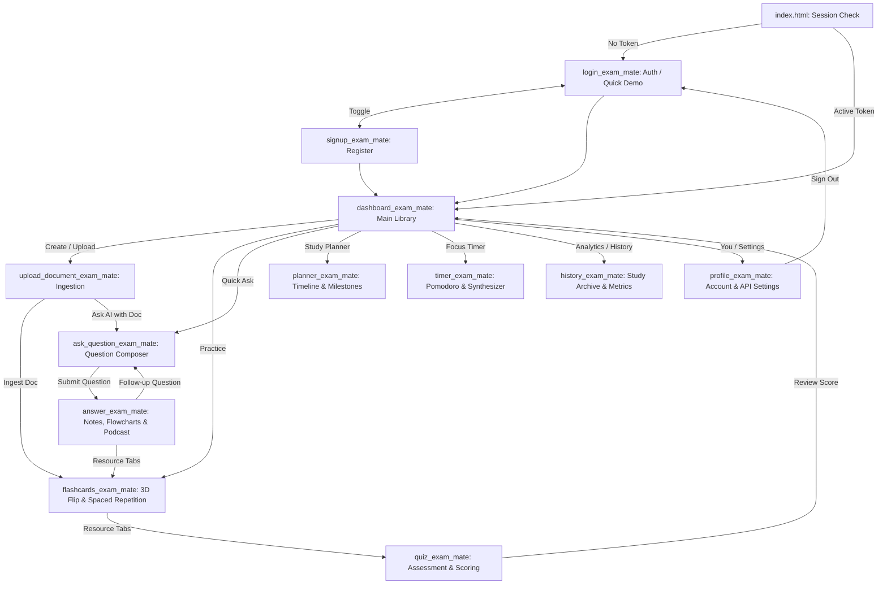

# Exam Mate AI — Otto Academic Study System


**Exam Mate AI** is a complete, production-ready AI notetaker and academic examination preparation platform inspired by the **Otto** study app design system (*Dribbble 27637592*). It delivers an interconnected, zero-dead-end study experience across 11 synchronized screens, backed by Groq LLM, TF-IDF document context retrieval, PostgreSQL on Supabase with Row Level Security (RLS), and a hybrid Flutter Android container.

---

## 🎨 Otto Design System & Visual Palette

Exam Mate AI adheres strictly to the Otto design tokens:
- **Canvas Background:** `#EFF0FA` (Soft lilac-tinted periwinkle)
- **Borders & Dividers:** `#BCC2F3` (Delicate periwinkle border line)
- **Secondary Iris Accent:** `#656DE2` (Electric lavender)
- **Primary Action Amber:** `#EC9205` (High-contrast, vibrant call-to-action)
- **Deep Onyx:** `#09090A` (Typography and selected states)
- **Warm Slate:** `#A6908B` (Secondary labels and metadata)
- **Electric Royal Blue:** `#121ECC` (Primary brand accent, audio cards, mascot)
- **Typography:** Plus Jakarta Sans & Inter, 28px border-radius containers, smooth micro-interactions.

---

## 📱 Complete Screen Architecture & User Flow

The application features a seamless, cohesive user journey where data flows continuously between all 11 modules:



### 11 Screens Breakdown:
1. **Entry & Session Routing (`index.html`):** Animated Otto mascot splash card that verifies local credentials and immediately routes active scholars to their dashboard.
2. **Authentication (`login_exam_mate/code.html`):** Clean sign-in with password toggle, direct Supabase auth integration, and a 1-click **Quick Demo Sign In** for reviewers.
3. **Registration (`signup_exam_mate/code.html`):** University-grade account creation with name, email, and password hashing.
4. **Library Dashboard (`dashboard_exam_mate/code.html`):** Displays study streak, active document decks, "Learned this week" progress card, search filter, and bottom navigation.
5. **Document Ingestion (`upload_document_exam_mate/code.html`):** Drag-and-drop or browse PDF, DOCX, PPTX, and TXT files. Features the Otto 60% circular progress sheet, automated TF-IDF chunking, and dual **Practice Flashcards** or **Ask AI Tutor** buttons.
6. **AI Question Composer (`ask_question_exam_mate/code.html`):** Context badge for attached documents, 5M/10M/16M exam depth selector, self-correcting Mermaid flowchart toggle, and curated academic topic shortcuts.
7. **Study Workspace & Podcast (`answer_exam_mate/code.html`):** Comprehensive exam answers formatted with equations and definitions, interactive Mermaid.js diagrams, and the **AI Podcast Player** with 1.0x/1.5x/2.0x playback and Web Speech API narration.
8. **3D Flashcards Practice (`flashcards_exam_mate/code.html`):** 3D perspective flip animation, spaced repetition ratings (*Again, Hard, Good, Easy*), text-to-speech pronunciation, and auto-generation from active documents.
9. **Interactive Quiz (`quiz_exam_mate/code.html`):** 5-10 multiple-choice questions with amber selection badges, instant feedback, and accuracy calculation.
10. **Semester Planner (`planner_exam_mate/code.html`):** Exam dates, milestone countdowns ("5 days left"), task strike-through completion, and modal to add/edit exams.
11. **Focus Timer (`timer_exam_mate/code.html`):** 25-minute Pomodoro timer paired with Web Audio API soundscape synthesizer (Gentle Rain, White Noise, Forest Birds, Cafe Ambience).
12. **Analytics & History (`history_exam_mate/code.html`):** Real-time study metrics (Total Qs, Active Streak, Uploaded Docs, Quiz Accuracy) with searchable history archive.
13. **Profile & Backend Settings (`profile_exam_mate/code.html`):** Scholar stats, dark/light theme, custom API endpoint configuration with live ping test, and safe sign-out.

---

## 🛠️ Tech Stack & Architecture

- **Backend:** Python 3.10+, Flask, Gunicorn, Werkzeug, PyJWT, Scikit-learn (TF-IDF), PyMuPDF (`fitz`), pdfplumber, python-docx, python-pptx, PaddleOCR.
- **Database:** Supabase PostgreSQL with Row Level Security (RLS) policies and atomic increment RPCs.
- **AI Engine:** Groq API (`openai/gpt-oss-20b` or `llama-3.3-70b-versatile`) with automatic rate-limit cooldown and fallback models.
- **Web Frontend:** Pure HTML5, Modern Vanilla CSS3, JavaScript ES6+, Mermaid.js, Web Speech API, Web Audio API.
- **Mobile Container:** Flutter 3.24+, `flutter_inappwebview` 6.0+, Java 17 (Eclipse Adoptium OpenJDK), Android Gradle Plugin 8.5.2, Gradle 8.7.

---

## 🗄️ Database Setup (Supabase)

The database schema is fully defined in [`aiassistant/backend/schema.sql`](file:///d:/projects/saais/aiassistant/backend/schema.sql).

### Steps to Apply:
1. Log into your [Supabase Dashboard](https://supabase.com/dashboard).
2. Open the **SQL Editor** in your project (`cxhxgtmedbldfmofortm`).
3. Paste and run the contents of `aiassistant/backend/schema.sql`.
4. The script creates:
   - `users`: Accounts, study streaks, document & question counts, last active timestamps.
   - `documents`: Uploaded file records, file types, summaries, chunk counts.
   - `questions`: History of queries, structured answers, Mermaid code.
   - `study_plans`: Upcoming exams, target dates, completion status.
   - `flashcards`: Spaced repetition cards, review counts, status.
   - `quizzes`: Quiz attempts, score percentages, questions JSONB.
   - `increment_documents_uploaded` & `increment_total_questions` RPCs.
   - RLS enabled with full client and backend access policies.

---

## 🚀 Local Development & Testing

### 1. Run the Web Application
Simply double-click:
```bat
d:\projects\saais\run_app.bat
```
*(Or run `d:\projects\saais\aiassistant\start_web.bat`)*
- Spins up a local HTTP server on `http://localhost:8080`.
- Automatically opens your default browser at `http://localhost:8080/index.html`.
- Works out-of-the-box with both live cloud APIs and intelligent demo fallbacks!

### 2. Run the Local Python Backend
Double-click:
```bat
d:\projects\saais\start_backend.bat
```
*(Or run `d:\projects\saais\aiassistant\backend\start_backend.bat`)*
- Activates virtual environment, installs dependencies from `requirements.txt`.
- Starts the Flask API on `http://0.0.0.0:5000`.

### 3. Build the Release Android APK
Double-click:
```bat
d:\projects\saais\build_apk.bat
```
- Automatically configures OpenJDK 17 (`C:\Program Files\Eclipse Adoptium\jdk-17.0.20.101-hotspot`).
- Links Gradle 8.7 and AGP 8.5.2.
- Executes `flutter build apk --release`.
- Generates the optimized APK at:
  `aiassistant/frontend/build/app/outputs/flutter-apk/app-release.apk`

---

## 🌐 Public Deployment Guide

### A. Backend Deployment (Render)
1. Fork or push this repository to GitHub.
2. Log into [Render](https://render.com) and click **New > Blueprint**.
3. Select your repository. Render will automatically detect [`render.yaml`](file:///d:/projects/saais/render.yaml).
4. Configure the environment variables in the Render dashboard:
   - `SUPABASE_URL`: `https://cxhxgtmedbldfmofortm.supabase.co`
   - `SUPABASE_KEY`: Your Supabase anon or service key.
   - `JWT_SECRET`: A secure random secret key.
   - `GROQ_API_KEY`: Your Groq API key from [console.groq.com](https://console.groq.com).
   - `CORS_ORIGINS`: `*` (or your Vercel public URL).
5. Render builds the Docker container with Gunicorn memory optimization.

### B. Web Deployment (Vercel)
1. Log into [Vercel](https://vercel.com) and click **Add New > Project**.
2. Import this repository.
3. Keep the Root Directory as `.` (or set to `aiassistant`). Both configurations are fully supported via the synchronized `vercel.json` rewrite rules.
4. Click **Deploy**.
5. Your web app is instantly live with zero 404 errors!

---

## 🛡️ License
Licensed under the MIT License. Built for students, researchers, and competitive exam scholars.
